🇰🇷 [한국어](README.md) · 🇺🇸 **English** · 🇯🇵 [日本語](README.ja.md)

# 🚀 AI & Data Analysis: Hands-On Level-Up (CLASS_PY_LIB_LEVELUP)

<p align="center">
  <a href="https://ldjwj.github.io/CLASS_PY_LIB_LEVELUP/README.en.html">
    
  </a>
  
  
  
  
</p>

> **A comprehensive, hands-on course that takes you all the way from applied Python programming to big data analysis, machine learning, and deep learning (CNN/RNN/GAN)!**  
> Systematically master Excel automation and GUI (Tkinter) development, exploration of public and time-series data, machine learning optimization, and modern deep learning models for computer vision and natural language processing.  
> ⭐️ If this helped your learning, please give the **Star** button at the top right a press!

> **Note:** All slides and notebooks (PDF/HTML) are in Korean. The code itself is language-independent, and your browser's built-in translation (e.g. Chrome) works on the HTML pages.

<p align="center">
  <a href="#️-complete-learning-roadmap">🗺️ Learning Roadmap</a> •
  <a href="#️-part-01-python-basics--practical-programming">🖥️ Part 1. Applied Python</a> •
  <a href="#-part-02-data-analysis--visualization-libraries">📊 Part 2. Visualization & Pandas</a> •
  <a href="#-part-03-machine-learning--recommender-systems">🤖 Part 3. Machine Learning</a> •
  <a href="#-part-04-real-world-big-data--text-analytics">📈 Part 4. Real-World Data</a> •
  <a href="#-part-05-deep-learning-fundamentals--applications-cnnrnngan">🧠 Part 5. Deep Learning</a>
</p>

---

## 🗺️ Complete Learning Roadmap

```mermaid
flowchart TD
    subgraph Part1 ["Part 01. Applied Python & Automation"]
        A["Review of Core Python Syntax & Functions/Modules"]
        B["Excel Data Automation (openpyxl)"]
        C["Desktop GUI Development with Tkinter"]
    end

    subgraph Part2 ["Part 02. Data Analysis & Geospatial Visualization"]
        D["Fine-Grained Visualization with Matplotlib & Seaborn"]
        E["Advanced Pandas Preprocessing (California Housing, Bike Sharing)"]
        F["Geospatial Visualization with Folium & Plotly"]
    end

    subgraph Part3 ["Part 03. Machine Learning & Recommendation Engines"]
        G["Supervised Learning (KNN, Decision Tree, Random Forest)"]
        H["Unsupervised Learning (PCA Dimensionality Reduction) & Recommender Systems"]
        I["Optimizing Model Evaluation Metrics"]
    end

    subgraph Part4 ["Part 04. Real-World Business Data & NLP"]
        J["Hands-On Kaggle (Adult Income, Spaceship Titanic)"]
        K["Time-Series Stock Analysis (Prophet)"]
        L["Text Mining (Frequency Analysis, Summarization, Topic Modeling)"]
    end

    subgraph Part5 ["Part 05. Modern Deep Learning"]
        M["Neural Network Basics & CNN (CIFAR-10, VGG16 Transfer Learning)"]
        N["Recurrent Neural Networks RNN/LSTM (IMDB Sentiment Analysis)"]
        O["Generative Adversarial Networks (GAN) & Style Transfer"]
        P["Automated Modeling with AutoML (PyCaret)"]
    end

    A --> B --> C --> D
    D --> E --> F --> G
    G --> H --> I --> J
    J --> K --> L --> M
    M --> N --> O --> P

    style Part1 fill:#EFF6FF,stroke:#3B82F6,stroke-width:1.5px
    style Part2 fill:#F0FDFA,stroke:#0D9488,stroke-width:1.5px
    style Part3 fill:#FEF3C7,stroke:#D97706,stroke-width:1.5px
    style Part4 fill:#FAF5FF,stroke:#7E22CE,stroke-width:1.5px
    style Part5 fill:#FFF1F2,stroke:#E11D48,stroke-width:1.5px
```



---

## 🖥️ PART 01. Python Basics & Practical Programming

Covers everything from a review of basic syntax to work automation (Excel) and building desktop GUI software.

| Topic | Hands-On Details | Materials |
|:---|:---|:---:|
| **Full Python Review** | Summary and review of core Python fundamentals | [📄 PDF](02_PYTHON/01_01_python_review.pdf) · [🌐 HTML](https://ldjwj.github.io/CLASS_PY_LIB_LEVELUP/02_PYTHON/01_01_python_review.html) |
| | Functions, lambdas, modules and packages in depth | [📄 PDF](02_PYTHON/01_04_fnc_lambda_module.pdf) · [🌐 HTML](https://ldjwj.github.io/CLASS_PY_LIB_LEVELUP/02_PYTHON/01_04_fnc_lambda_module.html) |
| **Excel Automation** | Automatically generating Excel sheets and extracting data with Python (1) | [📄 PDF](02_PYTHON/01_02A_project_excel_2207.pdf) · [🌐 HTML](https://ldjwj.github.io/CLASS_PY_LIB_LEVELUP/02_PYTHON/01_02A_project_excel_2207.html) |
| | Formatting large Excel files and automating reports (2) | [📄 PDF](02_PYTHON/01_02B_project_excel_2207.pdf) · [🌐 HTML](https://ldjwj.github.io/CLASS_PY_LIB_LEVELUP/02_PYTHON/01_02B_project_excel_2207.html) |
| **Tkinter GUI Development** | Tkinter basic widgets & the event loop | [💻 Code 01](02_PYTHON/01_03_tkinter/01_tkinter01_start_2210.py) · [💻 Code 02](02_PYTHON/01_03_tkinter/01_tkinter02_object_2210.py) |
| | [Practical GUI] Self-introduction program with file I/O | [💻 Source](02_PYTHON/01_03_tkinter/02_tk01_fileIo_SelfIntroduce_2210.py) |
| | [Practical GUI] Public data search application | [💻 Source](02_PYTHON/01_03_tkinter/02_tk02_dict01.py) |
| | [Practical GUI] Building a complete desktop calculator | [💻 Source 1](02_PYTHON/01_05B_cal.py) · [💻 Source 2](02_PYTHON/01_05C_cal.py) |

---

## 📊 PART 02. Data Analysis & Visualization Libraries

Hands-on practice with data collection and cleaning, high-quality chart visualization, and geospatial map visualization.

| Area | Topic | Details | Links |
|:---|:---|:---|:---:|
| **Understanding Data** | Data collection & EDA basics | Collecting structured data and the basic principles of visualization | [📄 PDF 01](https://ldjwj.github.io/CLASS_PY_LIB_LEVELUP/03_PY_LIB/00_01_데이터의이해및데이터수집.pdf) · [📄 PDF 02](https://ldjwj.github.io/CLASS_PY_LIB_LEVELUP/03_PY_LIB/00_02_python_dataVis_m_ver10.pdf) |
| **Matplotlib** | Basic plots & subplot layouts | Fine-grained styling and charting with Matplotlib | [📄 PDF](https://ldjwj.github.io/CLASS_PY_LIB_LEVELUP/03_PY_LIB/01_matplotlib_A.pdf) · [🌐 HTML](https://ldjwj.github.io/CLASS_PY_LIB_LEVELUP/03_PY_LIB/01_matplotlib_A.html) |
| | Visualizing public data in practice | Visualizing nationwide crime statistics from the Korean National Police Agency | [📄 PDF](https://ldjwj.github.io/CLASS_PY_LIB_LEVELUP/03_PY_LIB/06_P_경찰청_범죄데이터시각화_V10.pdf) · [🌐 HTML](https://ldjwj.github.io/CLASS_PY_LIB_LEVELUP/03_PY_LIB/06_P_경찰청_범죄데이터시각화_V10.html) |
| **Time-Series EDA** | Bike-sharing rental demand analysis | Analyzing bike usage patterns by hour and weather (1, 2) | [🌐 HTML 01](https://ldjwj.github.io/CLASS_PY_LIB_LEVELUP/03_PY_LIB/02_01_Bike_EDA_02_2107.html) · [🌐 HTML 02](https://ldjwj.github.io/CLASS_PY_LIB_LEVELUP/03_PY_LIB/02_01_Bike_EDA_03_2107.html) |
| **Pandas** | Data processing basics & practical applications | DataFrame manipulation and analysis of California housing price data | [📄 PDF](https://ldjwj.github.io/CLASS_PY_LIB_LEVELUP/03_PY_LIB/04_03_pandas_02_california_2504.pdf) · [🌐 HTML](https://ldjwj.github.io/CLASS_PY_LIB_LEVELUP/03_PY_LIB/04_03_pandas_02_california_2504.html) |
| **Geospatial Visualization** | Interactive maps with Folium | Mapping the locations of traditional markets in Seoul and across Korea | [📄 PDF](https://ldjwj.github.io/CLASS_PY_LIB_LEVELUP/03_PY_LIB/05_02_folium_market_2206.pdf) · [🌐 HTML](https://ldjwj.github.io/CLASS_PY_LIB_LEVELUP/03_PY_LIB/05_02_folium_market_2206.html) |
| **Plotly** | Interactive web charts | Building interactive graphs with Plotly | [📄 PDF](https://ldjwj.github.io/CLASS_PY_LIB_LEVELUP/03_PY_LIB/03_02_plotly_basic_iplot_2211.pdf) · [🌐 HTML](https://ldjwj.github.io/CLASS_PY_LIB_LEVELUP/03_PY_LIB/03_02_plotly_basic_iplot_2211.html) |

---

## 🤖 PART 03. Machine Learning & Recommender Systems

Implements classification and regression models for structured data, unsupervised learning, and recommendation algorithms.

* **Supervised Learning Models (KNN, Tree, Ensemble)**:
  * K-Nearest Neighbors (KNN) & decision tree algorithms: [Go to the machine learning repository](https://github.com/LDJWJ/ML_Basic_Class)
  * Ensemble random forest (hands-on with the Tips dataset)
* **Evaluation Metrics & Validation Strategies**:
  * Regression metrics (MSE, RMSE, R²) & classification metrics (Confusion Matrix, Precision/Recall, ROC-AUC)
* **Unsupervised Learning & Recommendation Engines**:
  * PCA (principal component analysis) and hands-on dimensionality reduction of a face image dataset
  * Movie recommender system based on a user-item rating matrix (collaborative filtering)

---

## 📈 PART 04. Real-World Big Data & Text Analytics

A hands-on part where you analyze real business datasets and natural-language text data.

* **Hands-On Kaggle Competition Analysis**:
  * **Spaceship Titanic**: missing-value imputation (`SimpleImputer`), label encoding, outlier exploration
  * **Adult Census Income Prediction Competition**: analysis of top solutions (1st, 2nd) and model optimization [🌐 Analysis Review](https://ldjwj.github.io/ML_Basic_Class/part03_ml/part03_pro_kaggle/kaggle_contest_4th_05_1st_review.html)
  * **Santander Customer Satisfaction Prediction** & **Wine Quality Classification Model**
* **Time-Series Stock Data Analysis (ibovespa-stocks)**:
  * Time-series modeling for stock price forecasting with Meta's Prophet library
* **Text Mining & NLP Analysis**:
  * Text frequency analysis & word clouds: [🌐 HTML](https://ldjwj.github.io/CLASS_PY_LIB_LEVELUP/06_DATA_ANALYSIS/텍스트데이터분석1_빈도분석_wc_V112.html) · [📄 PDF](https://ldjwj.github.io/CLASS_PY_LIB_LEVELUP/06_DATA_ANALYSIS/텍스트데이터분석1_빈도분석_wc_V112.pdf)
  * Automatic text summarization: [🌐 HTML](https://ldjwj.github.io/CLASS_PY_LIB_LEVELUP/06_DATA_ANALYSIS/텍스트데이터분석2_요약_wc_V112.html) · [📄 PDF](https://ldjwj.github.io/CLASS_PY_LIB_LEVELUP/06_DATA_ANALYSIS/텍스트데이터분석2_요약_wc_V112.pdf)
  * Topic modeling (LDA): [🌐 HTML](https://ldjwj.github.io/CLASS_PY_LIB_LEVELUP/06_DATA_ANALYSIS/텍스트데이터분석3_토픽모델링_wc_V112.html) · [📄 PDF](https://ldjwj.github.io/CLASS_PY_LIB_LEVELUP/06_DATA_ANALYSIS/텍스트데이터분석3_토픽모델링_wc_V112.pdf)

---

## 🧠 PART 05. Deep Learning Fundamentals & Applications (CNN/RNN/GAN)

Covers everything from the basics of artificial neural networks to computer vision, sequential natural language processing, and generative AI.

```
┌──────────────────────────┐      ┌──────────────────────────┐      ┌──────────────────────────┐
│ 👁️ Computer Vision (CNN) │ ---> │ 🗣️ NLP (RNN)             │ ---> │ 🎨 Generative Model (GAN)│
│ - CIFAR-10 image classif.│      │ - IMDB movie review      │      │ - Generative adversarial │
│ - VGG16 transfer learning│      │   sentiment analysis     │      │   networks               │
│                          │      │ - SimpleRNN, LSTM cells  │      │ - Neural Style Transfer  │
└──────────────────────────┘      └──────────────────────────┘      └──────────────────────────┘
```

1. **Neural Network Basics & Convolutional Neural Networks (CNN)**:
   * Getting started with deep learning (a Titanic neural network, CNN First/Second Model)
   * Object recognition and classification on CIFAR-10 color images
   * Dog vs Cat transfer learning with a pretrained model (VGG16)
2. **Recurrent Neural Networks (RNN / LSTM)**:
   * Sentiment classification of IMDB movie review text (word embeddings, LSTM architecture)
3. **Model Optimization & Regularization Techniques**:
   * Dropout, activation functions (LeakyReLU), and optimizing MNIST handwritten digit recognition
4. **Generative Models (GAN & Style Transfer)**:
   * How GANs (Generative Adversarial Networks) work
   * An AI art technique that blends painting styles (Neural Style Transfer)
5. **AutoML Automation**:
   * One-click automated model search with PyCaret, plus hands-on Spaceship Titanic prediction

---

## 🛠️ Development Environment Setup & License

* **Visual Studio Code Setup Manual**:  
  [📄 PDF Guide 01](01_START/01_[Window]01_visual_studio_code.pdf) · [📄 PDF Guide 02](01_START/01_[Window]02_visual_studio_code(2).pdf)
* **Contact**: Copyright inquiries and other partnerships: [frontier1020@naver.com](mailto:frontier1020@naver.com)
* **License**: All materials in this repository are licensed under [CC BY-NC-SA 4.0](https://creativecommons.org/licenses/by-nc-sa/4.0/deed.ko).
