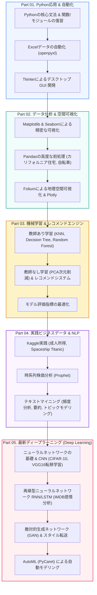

🇰🇷 [한국어](README.md) · 🇺🇸 [English](README.en.md) · 🇯🇵 **日本語**

# 🚀 AI＆データ分析 実践レベルアップ (CLASS_PY_LIB_LEVELUP)

<p align="center">
  <a href="https://ldjwj.github.io/CLASS_PY_LIB_LEVELUP/README.ja.html">
    
  </a>
  
  
  
  
</p>

> **Pythonの応用プログラミングからビッグデータ分析、機械学習、ディープラーニング（CNN/RNN/GAN）まで走り抜ける総合実践コースです！**  
> Excel自動化とGUI（Tkinter）制作、公共データ・時系列データの探索、機械学習の最適化、最新のディープラーニングによるコンピュータビジョンと自然言語処理モデルを体系的にマスターします。  
> ⭐️ 学習のお役に立ちましたら、右上の **Star** ボタンをぜひ押してください！

> **ご注意：** 教材（PDF/HTML）はすべて **韓国語** で書かれています。コードはそのまま実行でき、HTMLページはブラウザ（Chromeなど）の自動翻訳で読むことができます。

<p align="center">
  <a href="#️-総合学習ロードマップ">🗺️ 学習ロードマップ</a> •
  <a href="#️-part-01-pythonの基本--実践プログラミング">🖥️ Part 1. Python応用</a> •
  <a href="#-part-02-データ分析--可視化ライブラリ">📊 Part 2. 可視化 & Pandas</a> •
  <a href="#-part-03-機械学習--レコメンドシステム">🤖 Part 3. 機械学習</a> •
  <a href="#-part-04-実践ビッグデータ--テキスト分析">📈 Part 4. 実践データ</a> •
  <a href="#-part-05-ディープラーニングの基本と応用-cnnrnngan">🧠 Part 5. ディープラーニング</a>
</p>

---

## 🗺️ 総合学習ロードマップ



---

## 🖥️ PART 01. Pythonの基本 & 実践プログラミング

基礎文法の復習から業務自動化（Excel）、デスクトップGUIソフトウェアの制作までを扱います。

| テーマ | 実習内容の詳細 | 資料リンク |
|:---|:---|:---:|
| **Python総復習** | Pythonの基本の要点整理と復習 | [📄 PDF](02_PYTHON/01_01_python_review.pdf) · [🌐 HTML](https://ldjwj.github.io/CLASS_PY_LIB_LEVELUP/02_PYTHON/01_01_python_review.html) |
| | 関数、ラムダ（Lambda）、モジュール・パッケージの深掘り | [📄 PDF](02_PYTHON/01_04_fnc_lambda_module.pdf) · [🌐 HTML](https://ldjwj.github.io/CLASS_PY_LIB_LEVELUP/02_PYTHON/01_04_fnc_lambda_module.html) |
| **Excel自動化** | PythonによるExcelシートの自動生成とデータ抽出 (1) | [📄 PDF](02_PYTHON/01_02A_project_excel_2207.pdf) · [🌐 HTML](https://ldjwj.github.io/CLASS_PY_LIB_LEVELUP/02_PYTHON/01_02A_project_excel_2207.html) |
| | 大容量Excelの書式設定とレポートの自動化 (2) | [📄 PDF](02_PYTHON/01_02B_project_excel_2207.pdf) · [🌐 HTML](https://ldjwj.github.io/CLASS_PY_LIB_LEVELUP/02_PYTHON/01_02B_project_excel_2207.html) |
| **Tkinter GUI開発** | Tkinterの基本ウィジェット & イベントループ | [💻 コード 01](02_PYTHON/01_03_tkinter/01_tkinter01_start_2210.py) · [💻 コード 02](02_PYTHON/01_03_tkinter/01_tkinter02_object_2210.py) |
| | [実践GUI] ファイル入出力による自己紹介書プログラム | [💻 ソースコード](02_PYTHON/01_03_tkinter/02_tk01_fileIo_SelfIntroduce_2210.py) |
| | [実践GUI] 公共データ検索アプリケーション | [💻 ソースコード](02_PYTHON/01_03_tkinter/02_tk02_dict01.py) |
| | [実践GUI] デスクトップ電卓プログラムの完成 | [💻 ソースコード 1](02_PYTHON/01_05B_cal.py) · [💻 ソースコード 2](02_PYTHON/01_05C_cal.py) |

---

## 📊 PART 02. データ分析 & 可視化ライブラリ

データの収集と整形、高品質なチャートによる可視化、地理空間マップの可視化を実習します。

| 分野 | テーマ | 内容の詳細 | リンク |
|:---|:---|:---|:---:|
| **データの理解** | データ収集とEDAの基礎 | 構造化データの収集と可視化の基本原理 | [📄 PDF 01](https://ldjwj.github.io/CLASS_PY_LIB_LEVELUP/03_PY_LIB/00_01_데이터의이해및데이터수집.pdf) · [📄 PDF 02](https://ldjwj.github.io/CLASS_PY_LIB_LEVELUP/03_PY_LIB/00_02_python_dataVis_m_ver10.pdf) |
| **Matplotlib** | 基本プロット & サブプロットの構成 | Matplotlibによる精密なスタイリングとチャート作成 | [📄 PDF](https://ldjwj.github.io/CLASS_PY_LIB_LEVELUP/03_PY_LIB/01_matplotlib_A.pdf) · [🌐 HTML](https://ldjwj.github.io/CLASS_PY_LIB_LEVELUP/03_PY_LIB/01_matplotlib_A.html) |
| | 公共データ可視化の実践 | 韓国警察庁の全国犯罪発生統計データの可視化 | [📄 PDF](https://ldjwj.github.io/CLASS_PY_LIB_LEVELUP/03_PY_LIB/06_P_경찰청_범죄데이터시각화_V10.pdf) · [🌐 HTML](https://ldjwj.github.io/CLASS_PY_LIB_LEVELUP/03_PY_LIB/06_P_경찰청_범죄데이터시각화_V10.html) |
| **時系列EDA** | シェアサイクルの貸出需要分析 | 時間帯・天候別の自転車利用パターン分析 (1, 2) | [🌐 HTML 01](https://ldjwj.github.io/CLASS_PY_LIB_LEVELUP/03_PY_LIB/02_01_Bike_EDA_02_2107.html) · [🌐 HTML 02](https://ldjwj.github.io/CLASS_PY_LIB_LEVELUP/03_PY_LIB/02_01_Bike_EDA_03_2107.html) |
| **Pandas** | データ処理の基本 & 実務での応用 | DataFrameの操作とカリフォルニア住宅価格データの分析 | [📄 PDF](https://ldjwj.github.io/CLASS_PY_LIB_LEVELUP/03_PY_LIB/04_03_pandas_02_california_2504.pdf) · [🌐 HTML](https://ldjwj.github.io/CLASS_PY_LIB_LEVELUP/03_PY_LIB/04_03_pandas_02_california_2504.html) |
| **空間可視化** | Foliumによるインタラクティブ地図 | ソウルおよび韓国全国の伝統市場の位置情報を地図で可視化 | [📄 PDF](https://ldjwj.github.io/CLASS_PY_LIB_LEVELUP/03_PY_LIB/05_02_folium_market_2206.pdf) · [🌐 HTML](https://ldjwj.github.io/CLASS_PY_LIB_LEVELUP/03_PY_LIB/05_02_folium_market_2206.html) |
| **Plotly** | インタラクティブなWebチャート | Plotlyによるインタラクティブグラフの実装 | [📄 PDF](https://ldjwj.github.io/CLASS_PY_LIB_LEVELUP/03_PY_LIB/03_02_plotly_basic_iplot_2211.pdf) · [🌐 HTML](https://ldjwj.github.io/CLASS_PY_LIB_LEVELUP/03_PY_LIB/03_02_plotly_basic_iplot_2211.html) |

---

## 🤖 PART 03. 機械学習 & レコメンドシステム

構造化データの分類・回帰モデリング、教師なし学習、レコメンドアルゴリズムを実装します。

* **教師あり学習モデリング (KNN, Tree, Ensemble)**:
  * k近傍法（KNN）& 決定木アルゴリズム: [機械学習リポジトリへ](https://github.com/LDJWJ/ML_Basic_Class)
  * アンサンブル学習・ランダムフォレスト（Tipsデータセットで実習）
* **評価指標 & 検証戦略**:
  * 回帰の評価指標（MSE, RMSE, R²）& 分類の評価指標（Confusion Matrix, Precision/Recall, ROC-AUC）
* **教師なし学習 & レコメンドエンジン**:
  * PCA（主成分分析）と顔画像データセットの次元削減の実習
  * ユーザー×アイテム評価行列にもとづく映画レコメンドシステム（協調フィルタリング）

---

## 📈 PART 04. 実践ビッグデータ & テキスト分析

実際のビジネスデータセットと自然言語のテキストデータを分析する実践パートです。

* **Kaggle実践コンペティション分析**:
  * **Spaceship Titanic（宇宙版タイタニック）**: 欠損値の補完（`SimpleImputer`）、ラベルエンコーディング、外れ値の探索
  * **成人国勢調査（Adult Census）所得予測コンペ**: 上位ソリューション（1位・2位）の分析とモデル最適化 [🌐 分析レビュー](https://ldjwj.github.io/ML_Basic_Class/part03_ml/part03_pro_kaggle/kaggle_contest_4th_05_1st_review.html)
  * **サンタンデール（Santander）顧客満足度予測** & **ワイン品質判別モデル**
* **時系列株価データ分析 (ibovespa-stocks)**:
  * MetaのProphetライブラリを活用した株価予測の時系列モデリング
* **テキストマイニング & NLP分析**:
  * テキストの頻度分析 & ワードクラウド: [🌐 HTML](https://ldjwj.github.io/CLASS_PY_LIB_LEVELUP/06_DATA_ANALYSIS/텍스트데이터분석1_빈도분석_wc_V112.html) · [📄 PDF](https://ldjwj.github.io/CLASS_PY_LIB_LEVELUP/06_DATA_ANALYSIS/텍스트데이터분석1_빈도분석_wc_V112.pdf)
  * テキストの自動要約: [🌐 HTML](https://ldjwj.github.io/CLASS_PY_LIB_LEVELUP/06_DATA_ANALYSIS/텍스트데이터분석2_요약_wc_V112.html) · [📄 PDF](https://ldjwj.github.io/CLASS_PY_LIB_LEVELUP/06_DATA_ANALYSIS/텍스트데이터분석2_요약_wc_V112.pdf)
  * トピックモデリング (LDA): [🌐 HTML](https://ldjwj.github.io/CLASS_PY_LIB_LEVELUP/06_DATA_ANALYSIS/텍스트데이터분석3_토픽모델링_wc_V112.html) · [📄 PDF](https://ldjwj.github.io/CLASS_PY_LIB_LEVELUP/06_DATA_ANALYSIS/텍스트데이터분석3_토픽모델링_wc_V112.pdf)

---

## 🧠 PART 05. ディープラーニングの基本と応用 (CNN/RNN/GAN)

人工ニューラルネットワークの基礎から、コンピュータビジョン、系列データの自然言語処理、生成AIまでを扱います。

```
┌──────────────────────────┐      ┌──────────────────────────┐      ┌──────────────────────────┐
│ 👁️ 画像認識 (CNN)         │ ---> │ 🗣️ 自然言語処理 (RNN)     │ ---> │ 🎨 生成モデル (GAN)       │
│ - CIFAR-10 画像分類       │      │ - IMDB 映画レビュー       │      │ - 敵対的生成ネットワーク  │
│ - VGG16 転移学習          │      │   感情分析                │      │ - Neural Style Transfer  │
│                          │      │ - SimpleRNN, LSTM セル    │      │                          │
└──────────────────────────┘      └──────────────────────────┘      └──────────────────────────┘
```

1. **ニューラルネットワークの基礎 & 畳み込みニューラルネットワーク (CNN)**:
   * ディープラーニング入門（タイタニックのニューラルネットワーク、CNN First/Second Model）
   * CIFAR-10カラー画像の物体認識・分類
   * 事前学習済みモデル（VGG16）を活用したDog vs Catの転移学習（Transfer Learning）
2. **再帰型ニューラルネットワーク (RNN / LSTM)**:
   * IMDB映画レビューテキストの感情分類（単語埋め込み、LSTMの構造）
3. **モデルの最適化 & 正則化手法**:
   * Dropout、活性化関数（LeakyReLU）、MNIST手書き数字認識の最適化
4. **生成モデル (GAN & Style Transfer)**:
   * GAN（Generative Adversarial Network：敵対的生成ネットワーク）の原理
   * 画風を組み合わせるAIアートの手法（Neural Style Transfer）
5. **AutoMLによる自動化**:
   * PyCaretを活用したワンクリックでのモデル自動探索とSpaceship Titanic予測の実習

---

## 🛠️ 開発環境の設定 & ライセンス

* **Visual Studio Code 環境構築マニュアル**:  
  [📄 PDFガイド 01](01_START/01_[Window]01_visual_studio_code.pdf) · [📄 PDFガイド 02](01_START/01_[Window]02_visual_studio_code(2).pdf)
* **お問い合わせ**: 著作権に関するお問い合わせ・その他の提携: [frontier1020@naver.com](mailto:frontier1020@naver.com)
* **ライセンス**: 本リポジトリのすべての資料は [CC BY-NC-SA 4.0](https://creativecommons.org/licenses/by-nc-sa/4.0/deed.ko) ライセンスに従います。
