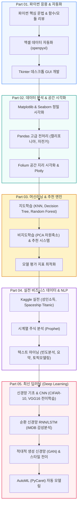

🇰🇷 **한국어** · 🇺🇸 [English](README.en.md) · 🇯🇵 [日本語](README.ja.md)

# 🚀 인공지능 & 데이터 분석 실전 레벨업 (CLASS_PY_LIB_LEVELUP)

<p align="center">
  <a href="https://ldjwj.github.io/CLASS_PY_LIB_LEVELUP/">
    
  </a>
  
  
  
  
</p>

> **파이썬 응용 프로그래밍부터 빅데이터 분석, 머신러닝, 딥러닝(CNN/RNN/GAN)까지 완주하는 종합 실전 과정!**  
> 엑셀 자동화 및 GUI(Tkinter) 제작, 공공데이터·시계열 데이터 탐색, 머신러닝 최적화, 최신 딥러닝 컴퓨터 비전 및 자연어 처리 모델을 체계적으로 마스터합니다.  
> ⭐️ 학습에 도움이 되셨다면 우측 상단의 **Star** 버튼을 꾹 눌러주세요!

<p align="center">
  <a href="#️-종합-학습-로드맵">🗺️ 학습 로드맵</a> •
  <a href="#️-part-01-파이썬-기본--실전-프로그래밍">🖥️ Part 1. 파이썬 응용</a> •
  <a href="#-part-02-데이터-분석--시각화-라이브러리">📊 Part 2. 시각화 & Pandas</a> •
  <a href="#-part-03-머신러닝--추천-시스템">🤖 Part 3. 머신러닝</a> •
  <a href="#-part-04-실전-빅데이터--텍스트-분석">📈 Part 4. 실전 데이터</a> •
  <a href="#-part-05-딥러닝-기본-및-응용-cnnrnngan">🧠 Part 5. 딥러닝</a>
</p>

---

## 🗺️ 종합 학습 로드맵



---

## 🖥️ PART 01. 파이썬 기본 & 실전 프로그래밍

기초 문법 복습부터 업무 자동화(엑셀), 데스크톱 GUI 소프트웨어 제작까지 다룹니다.

| 주제 | 상세 실습 내용 | 자료 링크 |
|:---|:---|:---:|
| **파이썬 전체 리뷰** | 파이썬 기본 핵심 요약 및 복습 | [📄 PDF](02_PYTHON/01_01_python_review.pdf) · [🌐 HTML](https://ldjwj.github.io/CLASS_PY_LIB_LEVELUP/02_PYTHON/01_01_python_review.html) |
| | 함수, 람다(Lambda), 모듈 패키지 심화 | [📄 PDF](02_PYTHON/01_04_fnc_lambda_module.pdf) · [🌐 HTML](https://ldjwj.github.io/CLASS_PY_LIB_LEVELUP/02_PYTHON/01_04_fnc_lambda_module.html) |
| **엑셀 자동화** | 파이썬으로 엑셀 시트 자동 생성 및 데이터 추출 (1) | [📄 PDF](02_PYTHON/01_02A_project_excel_2207.pdf) · [🌐 HTML](https://ldjwj.github.io/CLASS_PY_LIB_LEVELUP/02_PYTHON/01_02A_project_excel_2207.html) |
| | 대용량 엑셀 서식 지정 및 리포트 자동화 (2) | [📄 PDF](02_PYTHON/01_02B_project_excel_2207.pdf) · [🌐 HTML](https://ldjwj.github.io/CLASS_PY_LIB_LEVELUP/02_PYTHON/01_02B_project_excel_2207.html) |
| **Tkinter GUI 개발** | Tkinter 기초 위젯 & 이벤트 루프 | [💻 코드 01](02_PYTHON/01_03_tkinter/01_tkinter01_start_2210.py) · [💻 코드 02](02_PYTHON/01_03_tkinter/01_tkinter02_object_2210.py) |
| | [실전 GUI] 파일 입출력 자기소개서 프로그램 | [💻 소스코드](02_PYTHON/01_03_tkinter/02_tk01_fileIo_SelfIntroduce_2210.py) |
| | [실전 GUI] 공공데이터 검색 애플리케이션 | [💻 소스코드](02_PYTHON/01_03_tkinter/02_tk02_dict01.py) |
| | [실전 GUI] 데스크톱 계산기 프로그램 완성 | [💻 소스코드 1](02_PYTHON/01_05B_cal.py) · [💻 소스코드 2](02_PYTHON/01_05C_cal.py) |

---

## 📊 PART 02. 데이터 분석 & 시각화 라이브러리

데이터 수집 및 정제, 고품질 차트 시각화, 지리 공간 지도 시각화 실습입니다.

| 분야 | 주제 | 상세 내용 | 링크 |
|:---|:---|:---|:---:|
| **데이터 이해** | 데이터 수집 및 EDA 기초 | 정형 데이터 수집 및 시각화 기본 원리 | [📄 PDF 01](https://ldjwj.github.io/CLASS_PY_LIB_LEVELUP/03_PY_LIB/00_01_데이터의이해및데이터수집.pdf) · [📄 PDF 02](https://ldjwj.github.io/CLASS_PY_LIB_LEVELUP/03_PY_LIB/00_02_python_dataVis_m_ver10.pdf) |
| **Matplotlib** | 기본 플롯 & 서브플롯 구성 | Matplotlib 정밀 스타일링 및 차트 그리기 | [📄 PDF](https://ldjwj.github.io/CLASS_PY_LIB_LEVELUP/03_PY_LIB/01_matplotlib_A.pdf) · [🌐 HTML](https://ldjwj.github.io/CLASS_PY_LIB_LEVELUP/03_PY_LIB/01_matplotlib_A.html) |
| | 공공데이터 시각화 실전 | 경찰청 전국 범죄 발생 통계 데이터 시각화 | [📄 PDF](https://ldjwj.github.io/CLASS_PY_LIB_LEVELUP/03_PY_LIB/06_P_경찰청_범죄데이터시각화_V10.pdf) · [🌐 HTML](https://ldjwj.github.io/CLASS_PY_LIB_LEVELUP/03_PY_LIB/06_P_경찰청_범죄데이터시각화_V10.html) |
| **시계열 EDA** | 공유 자전거 대여 수요 분석 | 시간대/날씨별 자전거 이용 패턴 분석 (1, 2) | [🌐 HTML 01](https://ldjwj.github.io/CLASS_PY_LIB_LEVELUP/03_PY_LIB/02_01_Bike_EDA_02_2107.html) · [🌐 HTML 02](https://ldjwj.github.io/CLASS_PY_LIB_LEVELUP/03_PY_LIB/02_01_Bike_EDA_03_2107.html) |
| **Pandas** | 데이터 처리 기본 & 실무 응용 | DataFrame 조작 및 캘리포니아 주택 가격 데이터 분석 | [📄 PDF](https://ldjwj.github.io/CLASS_PY_LIB_LEVELUP/03_PY_LIB/04_03_pandas_02_california_2504.pdf) · [🌐 HTML](https://ldjwj.github.io/CLASS_PY_LIB_LEVELUP/03_PY_LIB/04_03_pandas_02_california_2504.html) |
| **공간 시각화** | Folium 지도 인터랙션 | 서울 및 전국 전통시장 위치 정보 지도 시각화 | [📄 PDF](https://ldjwj.github.io/CLASS_PY_LIB_LEVELUP/03_PY_LIB/05_02_folium_market_2206.pdf) · [🌐 HTML](https://ldjwj.github.io/CLASS_PY_LIB_LEVELUP/03_PY_LIB/05_02_folium_market_2206.html) |
| **Plotly** | 반응형 웹 차트 | Plotly 인터랙티브 그래프 구현 | [📄 PDF](https://ldjwj.github.io/CLASS_PY_LIB_LEVELUP/03_PY_LIB/03_02_plotly_basic_iplot_2211.pdf) · [🌐 HTML](https://ldjwj.github.io/CLASS_PY_LIB_LEVELUP/03_PY_LIB/03_02_plotly_basic_iplot_2211.html) |

---

## 🤖 PART 03. 머신러닝 & 추천 시스템

정형 데이터 분류·회귀 모델링 및 비지도학습, 추천 알고리즘을 구현합니다.

* **지도학습 모델링 (KNN, Tree, Ensemble)**:
  * K-최근접 이웃(KNN) & 의사결정트리 알고리즘: [머신러닝 저장소 바로가기](https://github.com/LDJWJ/ML_Basic_Class)
  * 앙상블 랜덤포레스트 (Tips 데이터셋 실습)
* **평가 지표 & 검증 전략**:
  * 회귀 평가지표 (MSE, RMSE, R²) & 분류 평가지표 (Confusion Matrix, Precision/Recall, ROC-AUC)
* **비지도학습 & 추천 엔진**:
  * PCA 주성분 분석 및 얼굴 이미지 데이터셋 차원 축소 실습
  * 사용자-아이템 평점 행렬 기반 영화 추천 시스템 (협업 필터링)

---

## 📈 PART 04. 실전 빅데이터 & 텍스트 분석

실제 비즈니스 데이터셋과 자연어 텍스트 데이터를 분석하는 실전 파트입니다.

* **Kaggle 실전 컴피티션 분석**:
  * **우주 타이타닉 (Spaceship Titanic)**: 결측치 대체(`SimpleImputer`), 라벨 인코딩, 이상치 탐색
  * **성인 인구조사 소득 예측 대회**: 상위 솔루션(1st, 2nd) 분석 및 모델 최적화 [🌐 분석 리뷰](https://ldjwj.github.io/ML_Basic_Class/part03_ml/part03_pro_kaggle/kaggle_contest_4th_05_1st_review.html)
  * **산탄데르(Santander) 고객 만족도 예측** & **와인 품질 판별 모델**
* **시계열 주식 데이터 분석 (ibovespa-stocks)**:
  * Meta의 Prophet 라이브러리를 활용한 주가 예측 시계열 모델링
* **텍스트 마이닝 & NLP 분석**:
  * 텍스트 빈도 분석 & 워드클라우드: [🌐 HTML](https://ldjwj.github.io/CLASS_PY_LIB_LEVELUP/06_DATA_ANALYSIS/텍스트데이터분석1_빈도분석_wc_V112.html) · [📄 PDF](https://ldjwj.github.io/CLASS_PY_LIB_LEVELUP/06_DATA_ANALYSIS/텍스트데이터분석1_빈도분석_wc_V112.pdf)
  * 텍스트 자동 요약: [🌐 HTML](https://ldjwj.github.io/CLASS_PY_LIB_LEVELUP/06_DATA_ANALYSIS/텍스트데이터분석2_요약_wc_V112.html) · [📄 PDF](https://ldjwj.github.io/CLASS_PY_LIB_LEVELUP/06_DATA_ANALYSIS/텍스트데이터분석2_요약_wc_V112.pdf)
  * 토픽 모델링 (LDA): [🌐 HTML](https://ldjwj.github.io/CLASS_PY_LIB_LEVELUP/06_DATA_ANALYSIS/텍스트데이터분석3_토픽모델링_wc_V112.html) · [📄 PDF](https://ldjwj.github.io/CLASS_PY_LIB_LEVELUP/06_DATA_ANALYSIS/텍스트데이터분석3_토픽모델링_wc_V112.pdf)

---

## 🧠 PART 05. 딥러닝 기본 및 응용 (CNN/RNN/GAN)

인공신경망의 기초부터 컴퓨터 비전, 시계열 자연어 처리, 생성형 AI까지 다룹니다.

```
┌────────────────────────┐      ┌────────────────────────┐      ┌────────────────────────┐
│  👁️ 컴퓨터 비전 (CNN)  │ ---> │  🗣️ 자연어 처리 (RNN)   │ ---> │  🎨 생성 모델 (GAN)     │
│  - CIFAR-10 이미지 분류│      │  - IMDB 영화 리뷰 감성 │      │  - 적대적 생성 신경망   │
│  - VGG16 전이학습 전이 │      │  - SimpleRNN, LSTM 셀  │      │  - Neural Style Transfer│
└────────────────────────┘      └────────────────────────┘      └────────────────────────┘
```

1. **신경망 기초 & 합성곱 신경망 (CNN)**:
   * 딥러닝 입문 (타이타닉 신경망, CNN First/Second Model)
   * CIFAR-10 컬러 이미지 객체 인식 분류
   * 사전 훈련 모델(VGG16)을 활용한 Dog vs Cat 전이학습(Transfer Learning)
2. **순환 신경망 (RNN / LSTM)**:
   * IMDB 영화 리뷰 텍스트 감성 분류 (단어 임베딩, LSTM 구조)
3. **모델 최적화 & 규제 기법**:
   * Dropout, 활성화 함수(LeakyReLU), MNIST 손글씨 인식 최적화
4. **생성 모델 (GAN & Style Transfer)**:
   * GAN(Generative Adversarial Network) 적대적 생성 신경망 원리
   * 화풍을 결합하는 인공지능 예술 기법 (Neural Style Transfer)
5. **AutoML 자동화**:
   * PyCaret을 활용한 원클릭 모델 자동 탐색 및 Spaceship Titanic 예측 실습

---

## 🛠️ 개발 환경 설정 & 라이선스

* **Visual Studio Code 환경 구축 매뉴얼**:  
  [📄 PDF 가이드 01](01_START/01_[Window]01_visual_studio_code.pdf) · [📄 PDF 가이드 02](01_START/01_[Window]02_visual_studio_code(2).pdf)
* **문의 사항**: 저작권 문의 및 기타 제휴: [frontier1020@naver.com](mailto:frontier1020@naver.com)
* **라이선스**: 본 저장소의 모든 자료는 [CC BY-NC-SA 4.0](https://creativecommons.org/licenses/by-nc-sa/4.0/deed.ko) 라이선스를 따릅니다.
